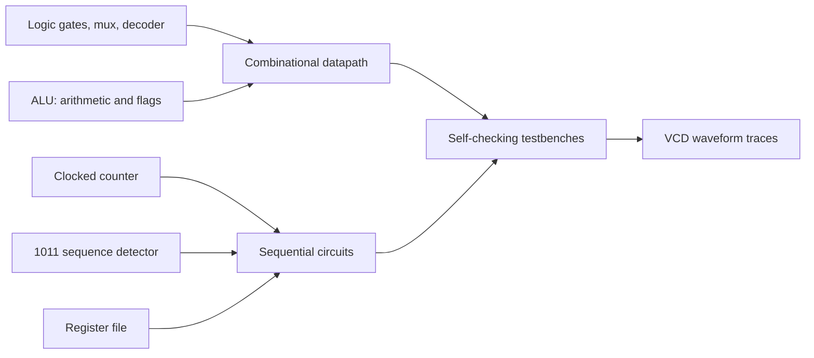

# Digital Logic & FPGA Design Lab

A small Verilog RTL laboratory with combinational circuits, a parameterized ALU, a counter, a sequence-detecting finite-state machine, and a register file. Self-checking testbenches generate VCD waveforms for inspection in GTKWave. The designs are synthesizable examples; simulator results must be verified in an HDL simulator before use in a physical FPGA project.

> **Learning portfolio project:** This repository contains independent educational designs and testbenches. It does not claim to be completed HAW Hamburg coursework or a tested FPGA deployment.

## Included designs

- Basic AND/OR/XOR/NAND/NOR/XNOR gates, a 4:1 mux, and a 3:8 decoder.
- An 8-bit-default combinational ALU with add/subtract, bitwise logic, signed less-than, carry, signed overflow, and zero flags.
- A synchronous-reset, enable-controlled modulo counter with a configurable terminal count.
- An overlapping Mealy finite-state machine that detects serial pattern `1011`.
- An 8-register default register file with two asynchronous read ports and synchronous writes; register zero is constant.
- Self-checking Verilog testbenches and waveform dumps for each design.

## Windows tools

Install Icarus Verilog (`iverilog` and `vvp`) for simulation. GTKWave is optional and opens the generated VCD traces. No Python packages are required; Python 3.10+ runs the cross-platform test runner.

From the repository root in PowerShell or Command Prompt:

```powershell
python scripts\run_tests.py
```

The runner compiles each testbench, stops on the first compile/simulation failure, and writes executables and VCD files under `build\`. Open a trace, for example, with:

```powershell
gtkwave build\tb_sequence_detector.vcd
```

If a simulator is not on PATH, add its installation directory to the current terminal PATH or invoke the runner from a terminal where `iverilog` and `vvp` are available. The runner reports a clear error when either tool is missing.

## Architecture



| Path | Purpose |
|---|---|
| `rtl/logic_gates.v` | Gates, 4:1 multiplexer, and 3:8 decoder |
| `rtl/alu.v` | Parameterized arithmetic/logic operations and flags |
| `rtl/counter.v` | Synchronous counter with reset, enable, and wrap value |
| `rtl/sequence_detector.v` | Overlapping Mealy FSM for `1011` |
| `rtl/register_file.v` | Small register array with constant-zero register |
| `tb/` | Stimulus, assertions, and VCD generation |
| `scripts/run_tests.py` | Compile/run orchestration for Icarus Verilog |

## Digital logic concepts

### Combinational logic

Combinational outputs depend only on current inputs. The ALU uses a `case` statement over a 3-bit operation code; the gate, mux, and decoder modules illustrate truth tables, selection, and one-hot decoding. There is no clocked state in these modules.

### ALU arithmetic and flags

The adder uses a `WIDTH+1`-bit intermediate so the most significant extension bit reports unsigned carry. For two's-complement addition, overflow occurs when operand signs agree but the result sign changes:

`V_add = ~(A_msb xor B_msb) & (R_msb xor A_msb)`

For subtraction, the sign relationship changes:

`V_sub = (A_msb xor B_msb) & (R_msb xor A_msb)`

The subtraction carry output is defined as **no borrow**. Signed less-than uses the signed interpretation of the operands; bitwise operations leave carry and overflow low.

### Clocked state and reset

The counter, FSM, and register file update state on the rising clock edge using nonblocking assignments. Reset is synchronous and active low. The counter changes only when enabled and wraps at `MAX_COUNT`; the register file's asynchronous read outputs update when addresses or stored values change.

### Finite-state machine

The sequence detector remembers the longest suffix that is also a prefix of `1011`. Its Mealy output is asserted when state `101` and input `1` coincide. The transition after detection retains the final `1`, allowing overlaps such as `1011011` to contain two matches.

## Verification and waveform workflow

The testbenches use directed stimulus and `$fatal` assertions, so a mismatch exits nonzero. The sequence detector bench intentionally checks an overlapping match; the ALU bench covers signed overflow, unsigned carry/no-borrow, signed comparison, and zero. VCD files are generated by simulation and are ignored by Git because they are build artifacts.

CI installs Icarus Verilog on an Ubuntu runner and executes `scripts/run_tests.py`. The local implementation environment did not include Icarus Verilog, `vvp`, or GTKWave, and outbound access to package repositories was blocked; therefore HDL compilation and VCD generation have **not** been claimed as locally verified.

## Experiments

1. Change ALU operands around signed boundaries (`0x7f + 1`, `0x80 - 1`) and inspect carry versus overflow.
2. Change the counter's `MAX_COUNT` and compare the wrap waveform.
3. Modify the input bitstream to test FSM overlaps and false prefixes.
4. Add a synchronous write collision test while reading the same register.
5. Open the VCD and compare state, next state, input, and Mealy output around the detected edge.

## Limitations and future work

- The current designs are simulation-oriented parameterized RTL; no FPGA pin constraints, clock constraints, or vendor-specific project files are supplied.
- The register file uses asynchronous reads, which may map differently across FPGA block RAM resources.
- No timing closure, synthesis, or hardware validation is claimed.
- Future work could add a serial UART controller, debounced buttons, display driver, and an FPGA board top-level with constraint files.

## Technical interview questions and answers

1. **What is the difference between combinational and sequential logic?** Combinational output depends on current inputs; sequential logic stores state and changes it at clock edges.
2. **What is carry versus signed overflow?** Carry describes unsigned extension beyond the word width; overflow describes a two's-complement result outside the signed representable range.
3. **Why use a `WIDTH+1` temporary in addition?** It preserves the extra unsigned carry bit that would otherwise be truncated.
4. **Why use nonblocking assignments for clocked state?** They model simultaneous edge-triggered register updates and avoid ordering races between sequential blocks.
5. **What does “synchronous reset” mean here?** Reset changes the state only at a rising clock edge while reset is active.
6. **Mealy versus Moore FSM?** A Mealy output depends on state and current input; a Moore output depends on state alone. This detector pulses as soon as the final input bit completes the pattern.
7. **How does the FSM detect overlaps?** After matching `1011`, it retains the suffix `1`, which is also a possible prefix of the next pattern.
8. **Why can asynchronous register-file reads be a problem on an FPGA?** Many block RAMs have synchronous read ports, so an asynchronous behavioral array may use distributed logic or require redesign.
9. **What is a self-checking testbench?** It compares outputs to expected values and terminates with a failing exit status when an assertion does not hold.
10. **What does a VCD show?** A time-ordered change log of selected signals that a waveform viewer can display for debugging timing and state transitions.

## License

MIT. See [LICENSE](LICENSE).
